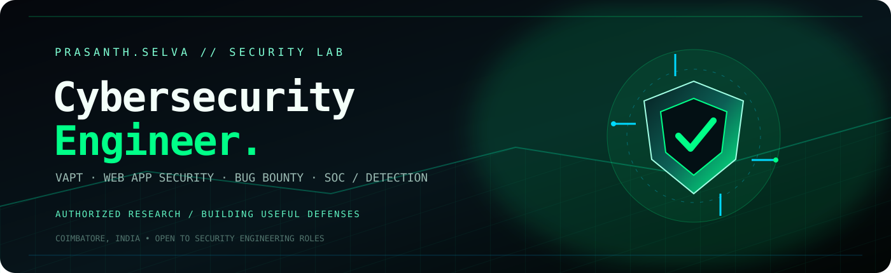
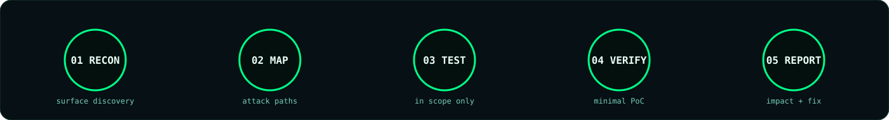

  
   
  
  
  
  

## `01 // IDENTITY`

> **I break web apps and APIs with permission, build useful security tooling, and ship polished full-stack products.**

I’m **Prasanth S**, a B.E. Computer Science and Engineering (Cybersecurity) student at **KGISL Institute of Technology, Coimbatore**. My working focus is vulnerability assessment and penetration testing, web application security, bug bounty research, SOC operations, and detection engineering.

I’ve worked across a SOC, a cybercrime police station, and a product startup. I also serve as **President of VYUGAM**, the cyber department association, where I lead a 12-member core team and help train **300+ students** through workshops, CTFs, and security events.

`VAPT`  ·  `WEB SECURITY`  ·  `BUG BOUNTY`  ·  `SOC / DETECTION`  ·  `FULL-STACK`

### Current operating context

| Signal | Status |
| :-- | :-- |
| Base | Coimbatore, India |
| Education | B.E. CSE (Cybersecurity) · KGISL Institute of Technology · graduating 2028 |
| Current role | Independent Security Researcher · authorized web/API testing |
| Community role | President · VYUGAM Cyber Department Association |
| Open to | Cybersecurity engineering roles, internships, and collaborations |

## `02 // EXPERIENCE`

- **Independent Security Researcher — Com olho** · Oct 2026 – present  
  Authorized security research on web applications and APIs: reconnaissance, access-control testing, security-configuration review, validation, and structured reporting.
- **Cyber Security Engineer Intern — LunaBlaze** · Jun – Jul 2026  
  Detection rules, SOC monitoring rotations, triage playbooks, Linux hardening, and internal threat reports.
- **Cybercrime Intern — Coimbatore Cybercrime Police Station** · Jun 2026  
  Evidence preservation, digital-trace analysis, online-fraud investigation support, and incident reporting.
- **Full-Stack Developer & Cybersecurity Analyst — Metazord / House of MetaZord** · Oct 2025 – Apr 2026  
  Threat monitoring, network-security reviews, hardening, alert tuning, and internal tools using Next.js and FastAPI.
- **President — VYUGAM, KGISL Cyber Department Association** · Oct 2025 – present  
  Workshops, CTFs, speaker sessions, security training, and event operations for a 300+ student community.

## `03 // ARSENAL`

## `04 // SELECTED BUILDS`

| Security & systems | Product & 3D experiences |
| :-- | :-- |
| [Auth Hydra — authentication security testing](https://prasanths-portfolio.vercel.app/projects/auth-hydra) | [LYWARO — interactive 3D e-commerce](https://prasanths-portfolio.vercel.app/projects/lywaro-3d-ecommerce) |
| [Container Ghost — Docker debugging benchmark](https://prasanths-portfolio.vercel.app/projects/container-ghost) | [Bugatti Chiron — Anatomy of Speed](https://prasanths-portfolio.vercel.app/projects/bugatti-chiron-3d) |
| [DDoS Mitigation & Traffic Defense](https://prasanths-portfolio.vercel.app/projects/ddos-mitigation) | [Porsche — automotive web experience](https://prasanths-portfolio.vercel.app/projects/porsche-automotive-experience) |
| [Adversarial Testing & Red Teaming](https://prasanths-portfolio.vercel.app/projects/adversarial-testing-red-teaming) | [BMW — interactive automotive showcase](https://prasanths-portfolio.vercel.app/projects/bmw-automotive-showcase) |
| [MediCore — AI hospital management](https://prasanths-portfolio.vercel.app/projects/medicore-hospital-management) | [Koenigsegg — immersive 3D experience](https://prasanths-portfolio.vercel.app/projects/koenigsegg-3d-experience) |

[View the complete project archive →](https://prasanths-portfolio.vercel.app/#projects)

## `05 // BUG BOUNTY LAB`

My testing lens is built around **access control**, **authentication and session flows**, **security configuration**, and **HTTP/REST request behavior**. My toolkit includes Linux, Bash, Python, Burp Suite, HTTP, and REST APIs. Programs I work with include **HackerOne, Bugcrowd, and YesWeHack**.

**Research rules:** authorized programs and in-scope assets only; minimal proof of concept; no unnecessary data access; clear impact, reproduction steps, and remediation; no disclosure before the program permits it.

> Disclosed write-ups will be listed here after coordinated disclosure.

## `06 // SIGNALS`

 

 

 

## `07 // ACHIEVEMENTS`

- **2nd of 48 teams** · Freshers CTF: Day Zer0 · Team ShadowArch · Oct 2026
- **Rank #23** · ATHENA CTF 2026 · Team CYB3RB0T5 · Jul 2026
- **National Finalist** · Breach Point CTF · Top 50+ · Mar 2026
- **Rank #84** · boroCTF 2026 Open Division · 9,700 points · Jun 2026
- **#160 of 1,076 individual / Team 61st** · RIFFHACK · Jun 2026
- **Final-round shortlist** · INNOHACK ’26, VIT Vellore · Jan 2026
- **President** · VYUGAM Cyber Department Association · 300+ students · Oct 2025 – present

Also competed in Pragyan ’26, Yukthi CTF 2.0, Synapse 2025, Shaastra AI Hackathon, SCTF 7.0, Null Origin CTF, LUN4R CTF, Trivarna CTF, ByteMe CTF, and UST GenCyS 2025.

## `08 // CERTIFICATIONS`

[Google Cybersecurity Professional Certificate](https://coursera.org/verify/professional-cert/F04EF7CKSDSP) · [Advanced Cybersecurity](https://coursera.org/verify/QJ88XQB6ZTOL) · [Ethical Hacking Fundamentals](https://coursera.org/verify/ZVLTI4TRU7AB) · [Metasploit for Beginners](https://coursera.org/verify/U7G81V47LRE6) · Cisco Ethical Hacker (70h) · Cybercrime Internship — TN Police

## `09 // CONNECT`

Have a security role, a project, or a bug to report? [Reach me through the portfolio](https://prasanths-portfolio.vercel.app/) or [connect on LinkedIn](https://linkedin.com/in/prasanth-selva-1511ps). I reply fast.

  
Breaking things responsibly since the first segfault.

